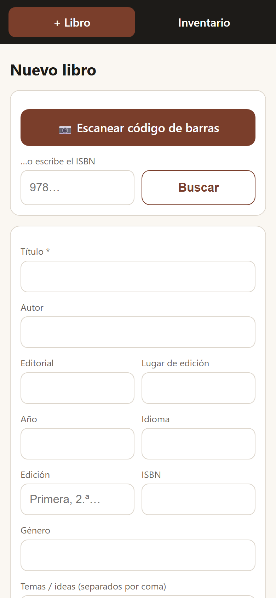
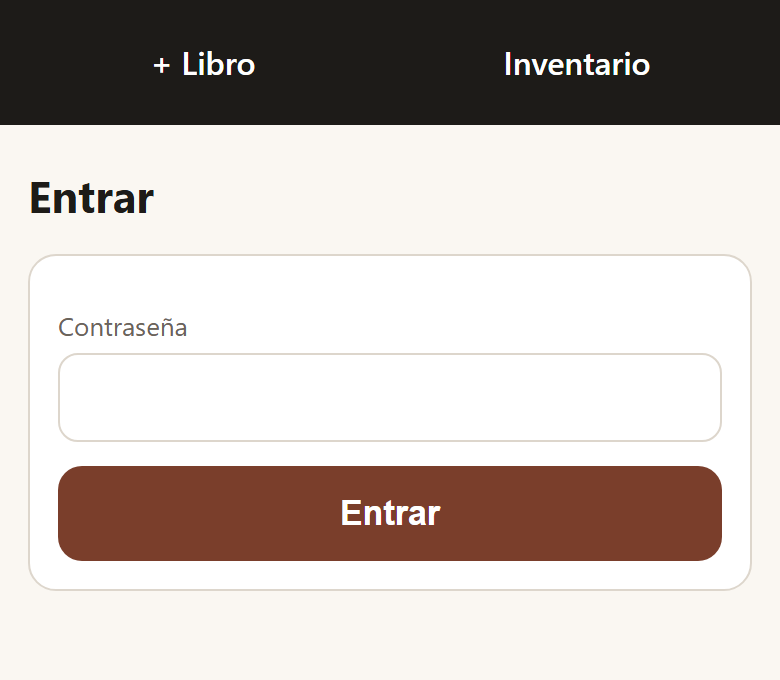

# GlossaLibros

App web en Flask para inventariar libros usados y antiguos desde el teléfono: se escanea el ISBN con la cámara, los datos se completan desde Open Library y Google Books, y se genera el texto para publicar el libro en Instagram.

**Versión actual: 0.1**, la primera versión funcional, pensada para uso personal en la red de la casa.

## Recorrido por la app

> Las capturas usan datos de demostración. Se ven como en un iPhone (390 px de ancho).

### 1. Agregar un libro

<p>
  
  &nbsp;
  
</p>

- **Escanear el código de barras:** el botón abre la cámara trasera del iPhone. Se saca la foto y el servidor lee el ISBN.
- **O escribir el ISBN:** acepta ISBN-10 e ISBN-13, con o sin guiones, y revisa el dígito verificador. Los ISBN-10 se convierten a ISBN-13.
- **Datos automáticos:** busca en Open Library y completa lo que falte con Google Books (título, autor, editorial, lugar, año, idioma, género, temas y portada). Si no encuentra el lugar de edición, lo deduce del prefijo del ISBN (Chile, España, México…).
- **Códigos antiguos:** si el código de barras no es un ISBN, como en algunos libros antiguos, la app muestra el número leído y pide escribir el ISBN impreso.
- **Duplicados:** si el ISBN escaneado ya está en el inventario, abre esa ficha para sumar stock.
- **"Guardar y agregar otro":** abre una ficha nueva con la ubicación y la procedencia ya llenas, para ingresar varios libros seguidos.

### 2. Ficha del ejemplar y texto para Instagram

<p>
  
  &nbsp;
  
</p>

- **Datos bibliográficos:** título, autor, editorial, lugar, año, idioma, edición, ISBN, género y temas.
- **Datos del ejemplar:** estado (de "Como nuevo" a "Deteriorado") con notas, precio en CLP, stock, ubicación física y procedencia.
- **Características:** casillas para primera edición, firmado o dedicado, tapa dura, ex libris, intonso, etc., más un campo libre.
- **Autocompletado:** los campos sugieren los valores ya usados, para escribirlos siempre igual.
- **Foto propia:** se reduce a 1600 px y acepta el formato HEIC del iPhone. Si no hay foto, se usa la portada del catálogo.
- **Texto para Instagram:** se genera con título, autor, datos de edición, características, estado, precio, llamado a comprar por DM y hashtags. Se puede editar y copiar con un botón.

### 3. Inventario

<p>
  
  &nbsp;
  
</p>

- **Búsqueda** por título, autor, ISBN o editorial.
- **Filtros** por género, tema, idioma y estado de Instagram.
- **Agrupar** por tema, género, idioma, ubicación o estado de Instagram.
- **Ordenar** por más recientes, título, autor, año o precio.
- **Resumen:** títulos, ejemplares y valor total del stock en CLP.
- **Estado de Instagram** (Pendiente, Listo, Publicado, Vendido) cambiable desde la lista. Al marcar "Publicado" se guarda la fecha.
- **Exportar a CSV** con los filtros activos. Se abre bien en Excel en español.

### 4. Acceso con contraseña



Opcional en la red de la casa y obligatoria si la app se publica en internet (ver [Configuración](#configuración)). El teléfono recuerda el acceso por 90 días.

## Limitaciones conocidas de la versión 0.1

- Marcar un libro como "Vendido" no descuenta stock ni registra la venta (fecha, precio, comprador).
- El aviso de duplicados solo funciona al escanear o buscar un ISBN, no al escribirlo directo en la ficha.
- Al cambiar la foto de un libro o eliminarlo, el archivo de la foto anterior no se borra.
- Solo una foto por libro (Instagram suele usar carruseles).
- El escaneo es por foto, no con video en vivo.
- Una sola contraseña compartida, sin usuarios ni historial de cambios.
- Se puede exportar a CSV, pero no importar.
- No hay filtros por ubicación, procedencia, estado del libro ni rango de precio.

## Instalación en Windows

Requiere [Python 3.12 o superior](https://www.python.org/downloads/). Durante la instalación, marca **"Add python.exe to PATH"**.

1. Descarga o clona este repositorio.
2. Haz doble clic en `instalar.bat`. Crea el entorno virtual e instala las dependencias; se hace una sola vez.
3. Haz doble clic en `iniciar.bat` cada vez que quieras usar la app.
4. En el iPhone, conectado al mismo WiFi, abre en Safari la dirección que aparece en la ventana (por ejemplo `http://192.168.1.20:5000`).

En otros sistemas:

```bash
python3 -m venv .venv
.venv/bin/pip install -r requirements.txt
.venv/bin/python app.py
```

## Respaldar y trasladar a otro PC

El entorno virtual (`.venv`) no se copia entre equipos: `instalar.bat` lo crea en cada PC. Lo que sí hay que llevar son los datos.

1. Cierra la app y haz doble clic en `respaldar.bat`. Crea en la carpeta `respaldos/` un zip con fecha que contiene `inventario.db` y `static/fotos/`.
2. En el otro PC, clona o descarga el repositorio y ejecuta `instalar.bat`.
3. Descomprime el zip dentro de la carpeta de la app, aceptando reemplazar los archivos, y abre `iniciar.bat`.

Guarda los respaldos fuera del PC (pendrive, Google Drive, etc.). La carpeta `respaldos/` tampoco se sube al repositorio.

## Configuración

Copia `.env.example` como `.env` y completa los valores que necesites. Todos son opcionales para usar la app en la red de la casa; `iniciar.bat` los carga automáticamente.

| Variable | Para qué sirve |
|---|---|
| `APP_PASSWORD` | Contraseña para entrar. **Obligatoria si la app se publica en internet.** |
| `SECRET_KEY` | Texto largo y al azar que firma la sesión. |
| `GOOGLE_BOOKS_KEY` | Clave gratuita de Google Books API, para no depender del límite diario compartido. |
| `OPENLIBRARY_EMAIL` | Correo de contacto que Open Library pide para identificar a la app. |

El archivo `.env`, la base de datos (`inventario.db`) y las fotos (`static/fotos/`) no se suben al repositorio.

## Publicar en PythonAnywhere (gratis)

1. Crea una cuenta **Beginner** en [pythonanywhere.com](https://www.pythonanywhere.com).
2. En una consola **Bash**:
   ```bash
   git clone https://github.com/DanGodfray/glossa_libros.git
   mkvirtualenv --python=python3.12 glossalibros
   pip install -r ~/glossa_libros/requirements.txt
   ```
3. En la pestaña **Web**: **Add a new web app**, luego **Manual configuration** y **Python 3.12**.
   - **Source code:** `/home/TUUSUARIO/glossa_libros`
   - **Virtualenv:** `/home/TUUSUARIO/.virtualenvs/glossalibros`
   - **Static files:** URL `/static/`, directorio `/home/TUUSUARIO/glossa_libros/static`
   - Activa **Force HTTPS**.
4. Reemplaza el contenido del archivo WSGI por:
   ```python
   import os, sys
   os.environ["APP_PASSWORD"] = "una-clave-larga"
   os.environ["SECRET_KEY"] = "un-texto-largo-y-al-azar"
   # os.environ["GOOGLE_BOOKS_KEY"] = "..."
   # os.environ["OPENLIBRARY_EMAIL"] = "..."
   sys.path.insert(0, "/home/TUUSUARIO/glossa_libros")
   from app import app as application
   ```
5. Toca **Reload**.

Para actualizar después de un cambio, ejecuta en la consola Bash `cd ~/glossa_libros && git pull` y toca **Reload**. Los datos no se tocan.

En el plan gratis hay que entrar a la pestaña Web cada 3 meses y extender la app, y el acceso a internet se limita a una lista de sitios permitidos.

## Estructura

```
app.py          Rutas de la app web
db.py           Base de datos SQLite
servicios.py    Lectura de códigos de barras, búsqueda en catálogos y texto para Instagram
templates/      Páginas HTML
static/fotos/   Fotos de los libros (no se suben al repositorio)
docs/           Capturas del README y el script que las genera
```

Para actualizar las capturas después de cambiar la interfaz (Windows con Microsoft Edge):

```bat
.venv\Scripts\python.exe docs\generar_capturas.py . docs\capturas %TEMP%\capturas_html
```

## Licencia

[MIT](LICENSE)
