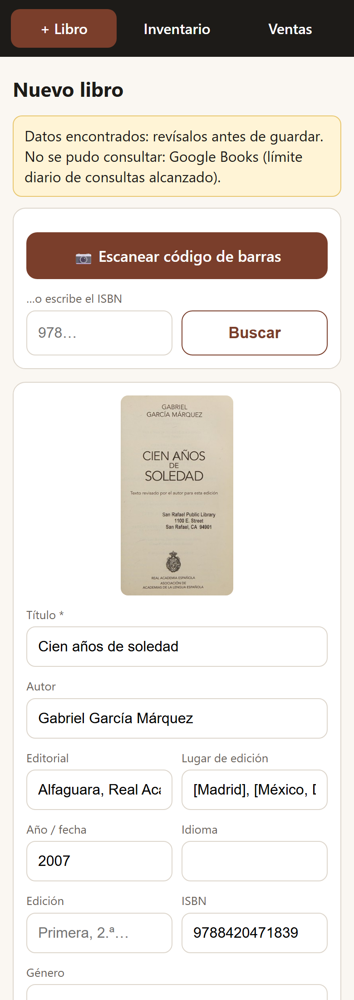
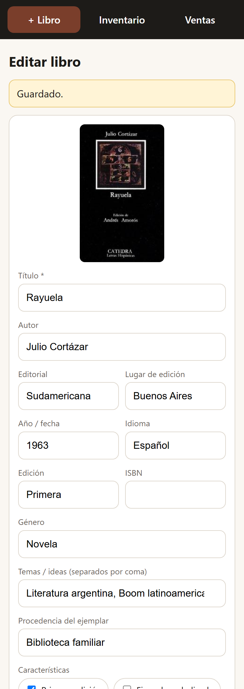
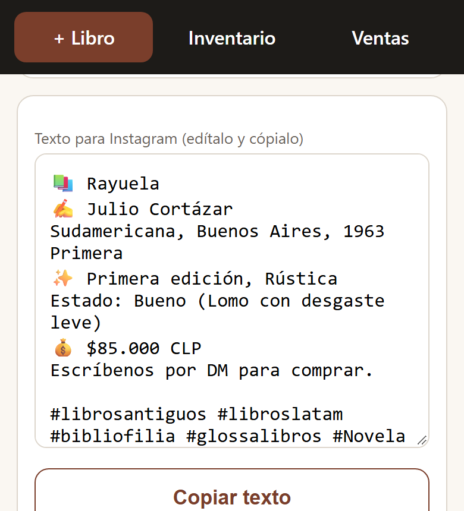
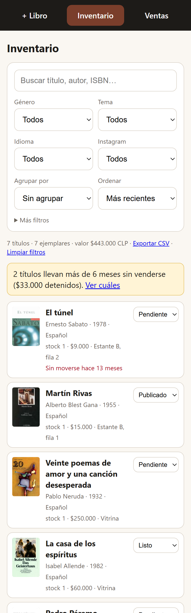
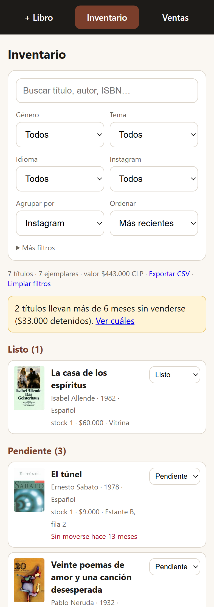
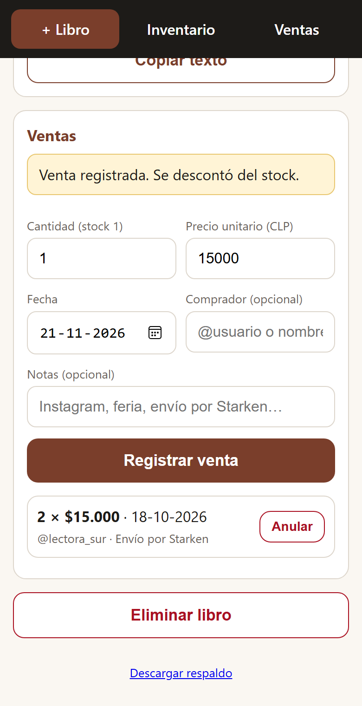
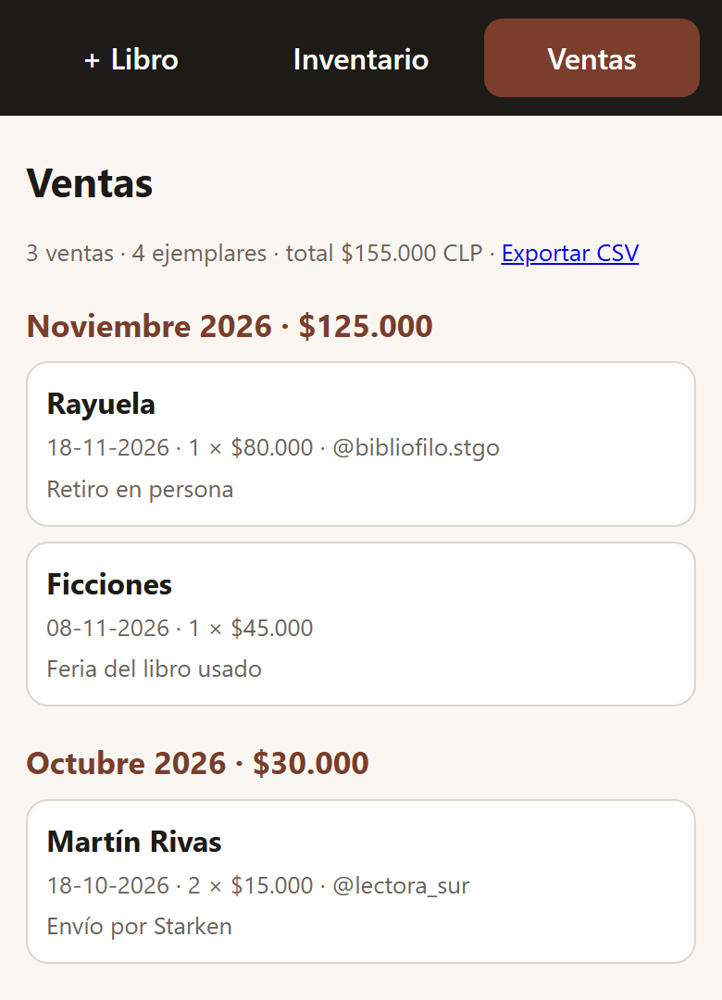
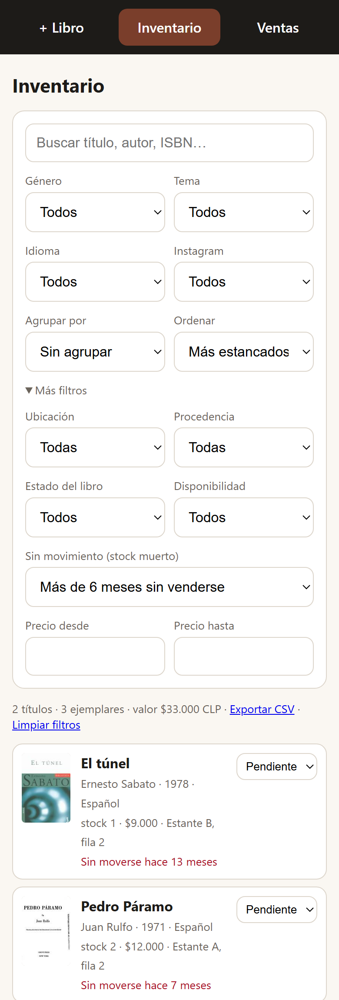
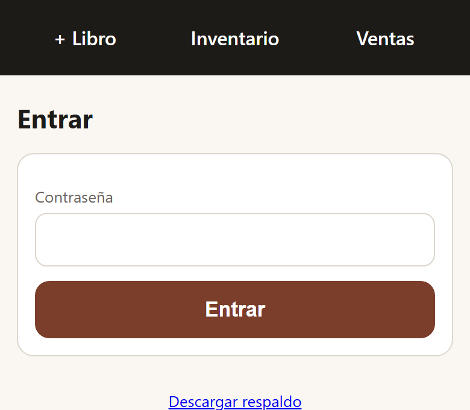

# GlossaLibros

App web en Flask para inventariar libros usados y antiguos desde el teléfono: se escanea el ISBN con la cámara, los datos se completan desde Open Library y Google Books, y se genera el texto para publicar el libro en Instagram.

**Versión actual: 0.3**, pensada para uso personal en la red de la casa. Ver [cambios por versión](#cambios-por-versión).

## Recorrido por la app

> Las capturas usan datos de demostración. Se ven como en un iPhone (390 px de ancho).

### 1. Agregar un libro

<p>
  
  &nbsp;
  
</p>

- **Escanear el código de barras:** el botón abre la cámara trasera del iPhone. Se saca la foto y el servidor lee el ISBN.
- **O escribir el ISBN:** acepta ISBN-10 e ISBN-13, con o sin guiones, y revisa el dígito verificador. Los ISBN-10 se convierten a ISBN-13.
- **Datos automáticos:** busca en Open Library y completa lo que falte con Google Books (título, autor, editorial, lugar, año, idioma, género, temas y portada). Si no encuentra el lugar de edición, lo deduce del prefijo del ISBN (Chile, España, México…). Si un catálogo no responde (por ejemplo, por el límite diario de Google Books), la app lo dice, en vez de dar a entender que el libro no existe.
- **Códigos antiguos:** si el código de barras no es un ISBN, como en algunos libros antiguos, la app muestra el número leído y pide escribir el ISBN impreso.
- **Duplicados:** si el ISBN escaneado ya está en el inventario, abre esa ficha para sumar stock. Si el ISBN se escribe directo en la ficha, avisa antes de guardar y permite crear una ficha aparte (útil si el ejemplar tiene otro estado o precio).
- **"Guardar y agregar otro":** abre una ficha nueva con la ubicación y la procedencia ya llenas, para ingresar varios libros seguidos.

### 2. Ficha del ejemplar y texto para Instagram

<p>
  
  &nbsp;
  
</p>

- **Datos bibliográficos:** título, autor, editorial, lugar, año o fecha, idioma, edición, ISBN, género y temas. La fecha se guarda tal como se escribe (`1923`, `c. 1890`, `1850-1860`, `[18--]`, `s.f.`); para ordenar se usa el primer año que aparezca.
- **Datos del ejemplar:** estado (de "Como nuevo" a "Deteriorado") con notas, precio en CLP, stock, ubicación física y procedencia. El precio acepta `$15.000`, `15000` o `15.000,50` (se redondea).
- **Características:** casillas para primera edición, firmado o dedicado, tapa dura, ex libris, intonso, etc., más un campo libre.
- **Autocompletado:** los campos sugieren los valores ya usados, para escribirlos siempre igual.
- **Foto propia:** se reduce a 1600 px y acepta el formato HEIC del iPhone. Si no hay foto, se usa la portada del catálogo, que se guarda una vez en la app para no depender de enlaces externos. Al cambiar la foto o eliminar el libro, el archivo anterior se borra. Si el archivo no es una imagen, la app avisa sin perder lo escrito.
- **Edición desde dos teléfonos:** si la ficha cambió en otro dispositivo mientras la editabas (por ejemplo, se vendió un ejemplar), la app no pisa ese cambio. Muestra tu versión con las diferencias para revisarla, y el stock se ajusta sobre el valor actual.
- **Texto para Instagram:** se genera con título, autor, datos de edición, características, estado, precio, llamado a comprar por DM y hashtags. Si el libro está agotado, dice "Vendido ✔". Se puede editar y copiar con un botón.

### 3. Inventario

<p>
  
  &nbsp;
  
</p>

- **Búsqueda** por título, autor, ISBN o editorial.
- **Filtros** por género, tema, idioma y estado de Instagram. En "Más filtros": ubicación, procedencia, estado del libro, disponibilidad (con stock o agotados), tiempo sin venderse y rango de precio.
- **Agrupar** por tema, género, idioma, ubicación, procedencia, estado del libro o estado de Instagram.
- **Ordenar** por más recientes, título, autor, año, precio o más estancados.
- **Resumen:** títulos, ejemplares y valor total del stock en CLP, siempre sobre todos los libros filtrados.
- **Páginas de 50 libros**, para que cargue rápido en el teléfono con un inventario grande.
- **Recuerda los filtros:** al volver al inventario desde el menú se mantiene la última búsqueda. "Limpiar filtros" la borra.
- **Estado de Instagram** (Pendiente, Listo, Publicado, Vendido) cambiable desde la lista. Al marcar "Publicado" se guarda la fecha. Al marcar "Vendido" un libro que aún tiene stock, la app lleva a registrar la venta.
- **Exportar a CSV** con los filtros activos, incluidos los días sin movimiento. Se abre bien en Excel en español.

### 4. Ventas

<p>
  
  &nbsp;
  
</p>

- **Registrar una venta** desde la ficha: cantidad, precio unitario, fecha, comprador y notas. El stock se descuenta y, si se agota, el libro pasa a "Vendido".
- **Anular una venta:** los ejemplares vuelven al stock.
- **Página de ventas:** todas las ventas agrupadas por mes, con el total de cada mes y el total general. Se pueden exportar a CSV.
- **El historial se conserva** aunque después se elimine el libro del inventario.

### 5. Stock muerto



- **Tiempo sin movimiento:** se cuenta desde la última venta del libro o, si nunca se vendió, desde que se ingresó.
- **Aviso en el inventario:** cuántos títulos llevan más de 6 meses sin venderse y cuánto dinero representan, con un enlace para verlos.
- **En cada tarjeta:** los libros con stock que llevan 3 meses o más sin venderse muestran "Sin moverse hace N meses".
- **Filtro** por más de 3, 6 o 12 meses sin venderse, y **orden** "Más estancados". Sirve para decidir qué rebajar, volver a publicar o llevar a una feria.

### 6. Acceso con contraseña



Opcional en la red de la casa y obligatoria si la app se publica en internet (ver [Configuración](#configuración)). El teléfono recuerda el acceso por 90 días. Las fotos también quedan protegidas por la contraseña. Al pie de cada página hay un enlace para cerrar sesión.

## Limitaciones conocidas

Están planificadas para las próximas versiones:

- **v0.4:** una sola contraseña compartida, sin usuarios ni historial de cambios; sin límite de intentos de contraseña ni protección CSRF; las fechas usan la hora del servidor (en PythonAnywhere, UTC).
- **v0.5:** sin valor de referencia de mercado; los libros sin ISBN no se buscan en los catálogos; sin reservas, pagos ni envíos; sin acciones masivas.
- **v0.6:** solo una foto por libro; no se puede importar desde CSV; el escaneo es por foto, no con video en vivo.

## Cambios por versión

### 0.3
- **Base técnica:** migraciones de la base de datos (las bases de versiones anteriores se actualizan solas, sin perder datos), pruebas automáticas en `tests/` y en GitHub Actions, y rutas configurables con `GLOSSA_DB` y `GLOSSA_FOTOS`.
- **Respaldo seguro:** se puede hacer con la app abierta, desde `respaldar.bat` o desde el enlace "Descargar respaldo" en el teléfono. Se conservan los 10 más recientes.
- **Edición desde dos teléfonos:** la ficha ya no pisa una venta hecha en otro dispositivo.
- **Correcciones:**
  - un libro con stock ya no queda "Vendido";
  - un archivo que no es imagen ya no rompe la app;
  - la fecha de edición acepta `1850-1860`, `[18--]` o `s.f.`;
  - los precios con decimales ya no se multiplican por 100;
  - el aviso distingue un catálogo caído de un libro que no existe;
  - las páginas de error están en español.
- **Inventario:** páginas de 50 libros con el resumen calculado sobre todos los libros filtrados, filtros recordados y portadas guardadas en la app.
- **Detalles:** fechas en formato 18-11-2026, enlace para cerrar sesión, texto de Instagram completo a la vista y "Vendido ✔" en libros agotados.

### 0.2
- **Ventas:** se registran con cantidad, precio, fecha, comprador y notas; descuentan stock y se pueden anular. Nueva página de ventas por mes, con exportación a CSV.
- **Stock muerto:** tiempo sin venderse de cada libro, aviso en el inventario, filtro y orden "Más estancados".
- **Más filtros:** ubicación, procedencia, estado del libro, disponibilidad y rango de precio.
- **Duplicados:** aviso también al escribir el ISBN directo en la ficha. Los ISBN se guardan normalizados.
- **Fotos:** al cambiar la foto o eliminar un libro se borra el archivo anterior.
- **Seguridad:** los nombres de archivo de las fotos ya no dependen de lo que se escriba en la ficha, y la app no borra archivos fuera de la carpeta de fotos.

### 0.1
- Primera versión funcional: ingreso por escaneo o ISBN, datos automáticos, ficha del ejemplar, texto para Instagram, inventario con filtros y CSV, contraseña opcional.

## Instalación en Windows

Requiere [Python 3.12 o superior](https://www.python.org/downloads/). Durante la instalación, marca **"Add python.exe to PATH"**.

1. Descarga o clona este repositorio.
2. Haz doble clic en `instalar.bat`. Crea el entorno virtual e instala las dependencias; se hace una sola vez.
3. Haz doble clic en `iniciar.bat` cada vez que quieras usar la app.
4. En el iPhone, conectado al mismo WiFi, abre en Safari la dirección que aparece en la ventana (por ejemplo `http://192.168.1.20:5000`).

En otros sistemas:

```bash
python3 -m venv .venv
.venv/bin/pip install -r requirements.txt
.venv/bin/python app.py
```

## Respaldar y trasladar a otro PC

El entorno virtual (`.venv`) no se copia entre equipos: `instalar.bat` lo crea en cada PC. Lo que sí hay que llevar son los datos.

1. Crea un respaldo de una de estas dos formas. Las dos funcionan aunque la app esté abierta.
   - Haz doble clic en `respaldar.bat`. Crea en la carpeta `respaldos/` un zip con fecha que contiene `inventario.db` y `static/fotos/`, y conserva los 10 más recientes.
   - Desde el teléfono, toca **Descargar respaldo** al pie de cualquier página. También funciona con la app publicada en internet.
2. En el otro PC, clona o descarga el repositorio y ejecuta `instalar.bat`.
3. Con la app cerrada, descomprime el zip dentro de la carpeta de la app, aceptando reemplazar los archivos, y abre `iniciar.bat`.

Guarda los respaldos fuera del PC (pendrive, Google Drive, etc.). La carpeta `respaldos/` tampoco se sube al repositorio. Si el respaldo viene de una versión anterior, la base se actualiza sola al abrir la app.

## Configuración

Copia `.env.example` como `.env` y completa los valores que necesites. Todos son opcionales para usar la app en la red de la casa; `iniciar.bat` los carga automáticamente.

| Variable | Para qué sirve |
|---|---|
| `APP_PASSWORD` | Contraseña para entrar. **Obligatoria si la app se publica en internet.** |
| `SECRET_KEY` | Texto largo y al azar que firma la sesión. |
| `GOOGLE_BOOKS_KEY` | Clave gratuita de Google Books API, para no depender del límite diario compartido. |
| `OPENLIBRARY_EMAIL` | Correo de contacto que Open Library pide para identificar a la app. |
| `GLOSSA_DB`, `GLOSSA_FOTOS` | Ubicación de la base de datos y de la carpeta de fotos, si no quieres que estén dentro de la carpeta de la app. |

El archivo `.env`, la base de datos (`inventario.db`) y las fotos (`static/fotos/`) no se suben al repositorio.

## Publicar en PythonAnywhere (gratis)

1. Crea una cuenta **Beginner** en [pythonanywhere.com](https://www.pythonanywhere.com).
2. En una consola **Bash**:
   ```bash
   git clone https://github.com/DanGodfray/glossa_libros.git
   mkvirtualenv --python=python3.12 glossalibros
   pip install -r ~/glossa_libros/requirements.txt
   ```
3. En la pestaña **Web**: **Add a new web app**, luego **Manual configuration** y **Python 3.12**.
   - **Source code:** `/home/TUUSUARIO/glossa_libros`
   - **Virtualenv:** `/home/TUUSUARIO/.virtualenvs/glossalibros`
   - Activa **Force HTTPS**.
   - No hace falta configurar archivos estáticos: las fotos las sirve la app, protegidas por la contraseña.
4. Reemplaza el contenido del archivo WSGI por:
   ```python
   import os, sys
   os.environ["APP_PASSWORD"] = "una-clave-larga"
   os.environ["SECRET_KEY"] = "un-texto-largo-y-al-azar"
   # os.environ["GOOGLE_BOOKS_KEY"] = "..."
   # os.environ["OPENLIBRARY_EMAIL"] = "..."
   sys.path.insert(0, "/home/TUUSUARIO/glossa_libros")
   from app import app as application
   ```
5. Toca **Reload**.

Para actualizar después de un cambio, ejecuta en la consola Bash `cd ~/glossa_libros && git pull` y toca **Reload**. Los datos no se tocan.

En el plan gratis hay que entrar a la pestaña Web cada 3 meses y extender la app, y el acceso a internet se limita a una lista de sitios permitidos.

## Estructura

```
app.py          Rutas de la app web
db.py           Base de datos SQLite y sus migraciones
servicios.py    Lectura de códigos de barras, búsqueda en catálogos, portadas y texto para Instagram
respaldo.py     Respaldo de la base y las fotos en un zip
templates/      Páginas HTML
static/fotos/   Fotos de los libros (no se suben al repositorio)
tests/          Pruebas automáticas
docs/           Capturas del README y el script que las genera
```

Para correr las pruebas:

```bat
.venv\Scripts\python.exe -m pip install -r requirements-dev.txt
.venv\Scripts\python.exe -m pytest
```

Para cambiar el esquema de la base de datos, agrega una migración nueva al final de `MIGRACIONES` en `db.py`; nunca edites una que ya se publicó.

Para actualizar las capturas después de cambiar la interfaz (Windows con Microsoft Edge):

```bat
.venv\Scripts\python.exe docs\generar_capturas.py . docs\capturas %TEMP%\capturas_html
```

## Licencia

[MIT](LICENSE)
